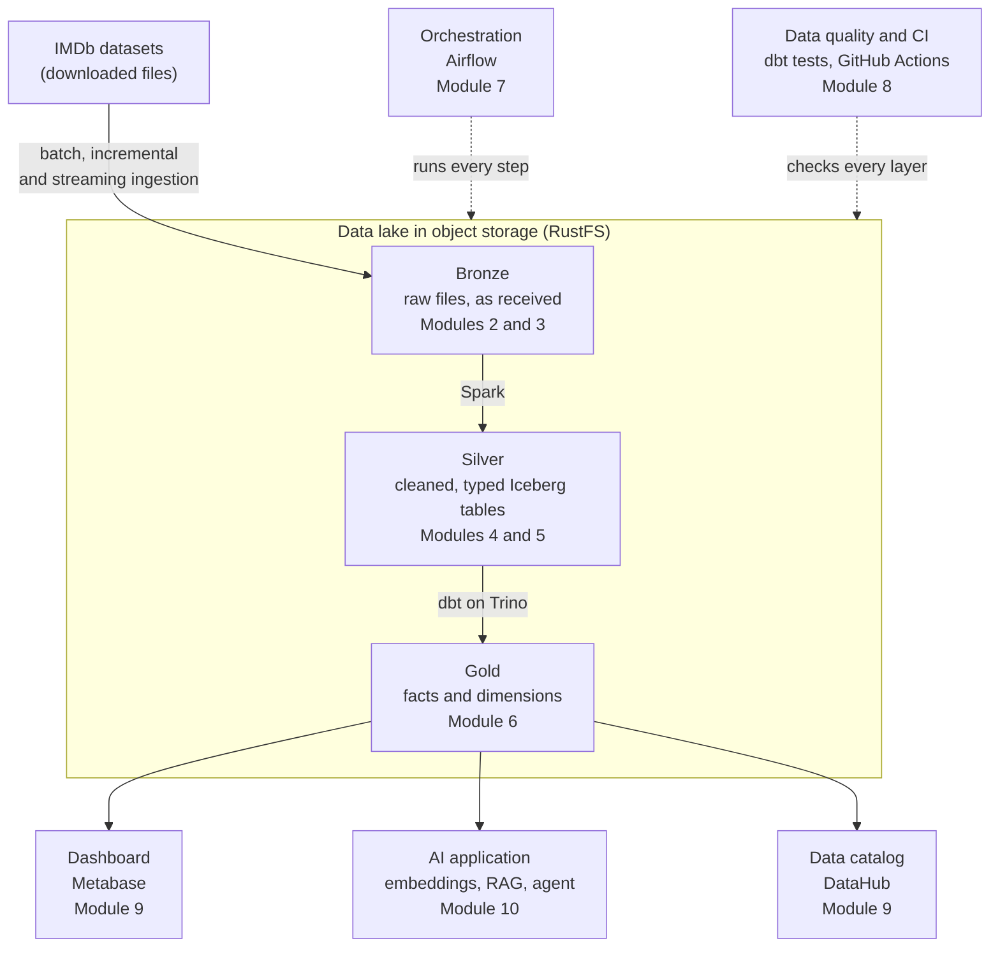

# Architecture

This is the platform you build during the course. Each box names the module where you add it.

## The pieces

| Piece | What it does | Tool | Module |
| --- | --- | --- | --- |
| Object storage | Holds every file of the data lake | RustFS | 0 |
| Toolbox | Runs course scripts and checkpoints | Python | 0 |
| Ingestion | Brings data in: all at once, only what changed, or continuously | Python, Kafka | 3 |
| Bronze layer | Keeps the data exactly as it arrived | Parquet files | 2, 3 |
| Processing | Cleans and standardizes large data | Spark | 4 |
| Silver layer | Holds clean tables that can be updated safely | Iceberg | 5 |
| Query engine | Runs SQL over the lake | Trino | 5 |
| Transformation | Builds business tables from clean ones, with tests | dbt | 6 |
| Gold layer | Holds the tables people and applications use | Iceberg | 6 |
| Orchestration | Runs the steps in order, on a schedule | Airflow | 7 |
| Data quality and CI | Stops bad data and bad changes | dbt tests, GitHub Actions | 8 |
| Dashboard | Shows the data to people | Metabase | 9 |
| Data catalog | Lets people find tables and see where they come from | DataHub | 9 |
| AI application | Answers questions from the curated data | pgvector, a local model, MCP | 10 |

## Bronze, silver, gold

The lake is split into three layers, each with one job.

- **Bronze** keeps the data exactly as it arrived. If something goes wrong later, you can always start again from here.
- **Silver** holds the same data after cleaning: correct types, consistent names, no duplicates.
- **Gold** holds tables shaped for a purpose: a dashboard, a report, an application.

Data only moves forward, from bronze to silver to gold. This layout is often called the medallion architecture.
